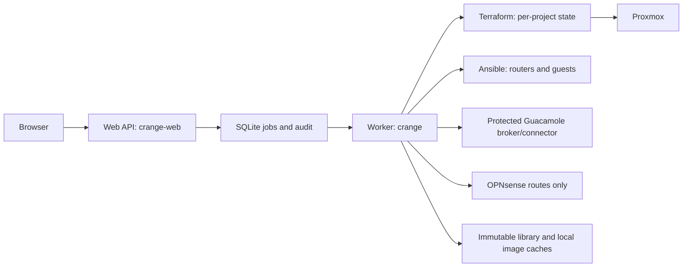
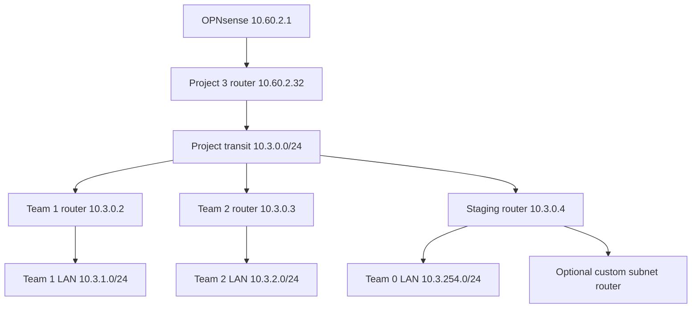

# How CRANGE works

[Documentation index](../README.md) · [Administrator guide](administrator-guide.md)

## Control plane and desired state

CRANGE combines a same-origin browser/API dashboard, a typed persistent job queue, fixed CLI workflows, Terraform and Ansible. The browser describes approved actions, not shell commands. `scripts/crange_server.py` checks sessions, CSRF and project roles; `scripts/crange_jobs.py` validates operation fields and constructs reviewed argument vectors. The worker invokes `scripts/crange.py` to edit desired state or execute guarded workflows.

Installed web and worker services run as separate unprivileged users. The web user does not read worker credentials. The optional Unix-socket broker encrypts secrets and signs short-lived Guacamole tickets without exposing its key to the web app. The installer currently binds the web service to `0.0.0.0:8000`; standalone `serve` defaults to loopback. Network access control is therefore an administrator responsibility.

Projects live under `terraform/environments/project-NNN`, each with independent state. `crange.auto.tfvars.json` holds CLI-managed declarations; existing HCL inputs can be imported into the standardized representation. Preserve real project inputs and state. `project-template` contains reusable source, never Project 3's state. Generated inventory comes from Terraform outputs, so configuration targets applied identities rather than assuming desired declarations are already deployed.

Retained plans record exact inputs/state and integrity metadata. Apply rejects stale/expired plans and unexpected deletion/replacement unless specifically allowed. Staging deployment further checks that the plan stays within staging scope. Release operations maintain selected-team rollout records and verify deployed physical identity before checks.

## Routing and isolation

The shared access network is `10.60.0.0/24`; shared project-router transit is `10.60.2.0/24` on `crtrans`. The Proxmox `crange` SDN zone uses VXLAN. Project transit VNet names are `pNNNtr`; team VNets are `pNNNtNNN`. Ordinary team LANs are `10.P.T.0/24`. Team 0 maps to ID 254 and uses `10.P.254.0/24`.

OPNsense needs one aggregate route `10.P.0.0/16` via the project's shared-transit address. Debian project routers install specific downstream return routes, including staging and custom subnets. The inventory generator supplies persistent `router_routes`; Ansible writes an if-up/down route hook.

Debian routers are unprivileged LXCs with UFW routed default deny. Explicit permissions preserve DHCP/DNS, allowed egress and exact controller/Guacamole endpoints while blocking other project/team/internal networks. Staging is a team LAN, not unrestricted project transit. Router configuration runs project routers first, then downstream routers over an SSH proxy. Only the intended sysctl file is loaded; `sysctl --system` is unsuitable here. OPNsense project automation manages routes/gateways only and never firewall rules.

## Images, releases and distribution

Approved VM/container catalogs constrain image selection. Administrators maintain base OS images; managers derive project-scoped scenario images. Template approvals, project presets, staging guests, immutable release manifests and deployed clones are different objects. An alias or preset update cannot rewrite an existing release.

The library on proxmox5 stores complete immutable archives and metadata. Verified caches on destination nodes provide local image bases; eligible guests use linked clones from the exact local node/datastore. Runtime guest disks are not implicitly placed on NFS. Existing clones and native snapshots pin their backing bases until dependency checks prove safe removal.

Automatic placement currently runs as a restricted P1 pilot for the published Alpine 3.24 image and verified `p003t254` network path. The protected policy allows only proxmox1; this does not establish multi-node acceptance. The image retains `captured_source_identity: false` as a provenance limitation. Discovery considers the entire cluster, including stopped guests; admission reserves conservative CPU/memory, full virtual disk growth, cache base/probe/transfer overhead and storage headroom. Preferences are soft, concrete node selections are hard pins, and existing applied placement remains authoritative. Running/uncertain reservations do not simply expire. Cache preparation is an explicit audited staging/admin workflow; plain plan previews do not copy images.

Native snapshots remain in local storage. An archived restore point captures one complete guest state/configuration, not the complete native snapshot tree. Neither image publication nor a checksum alone proves restored guest readiness, isolation or identity uniqueness. See [distribution operations](distribution-operations.md), [library deployment](library-deployment.md) and [acceptance plan](../DISTRIBUTION-PLAN.md).

## Source map

| Location | Responsibility |
| --- | --- |
| `gui/` | Dashboard and forms |
| `scripts/crange_server.py`, `crange_auth.py` | API, sessions, roles, audit |
| `scripts/crange_jobs.py`, `crange_service.py` | Fixed jobs and service separation |
| `scripts/crange.py` | Project desired state, guarded plans and workflows |
| `scripts/crange_staging.py`, `crange_rollouts.py` | Staging scope and release rollout records |
| `scripts/crange_catalog.py`, `crange_distribution.py`, `crange_image_cache.py` | Immutable image identity, archives, verified caches |
| `scripts/crange_placement.py`, `crange_scheduling.py` | Admission, reservations and applied placement |
| `scripts/crange_guac*.py`, `guacamole/` | Connections, accounts, ticket broker and presentation extension |
| `scripts/crange_box_users.py`, `crange_guest*.py` | Guest accounts, protected credentials and identity checks |
| `terraform/modules/`, `terraform/environments/` | Reviewed infrastructure modules and separate projects |
| `ansible/`, `scripts/generate-project-inventory.py` | Router/guest configuration and Terraform-backed inventory |
| `tests/` | Isolated behavioral tests; not substitutes for live acceptance |
